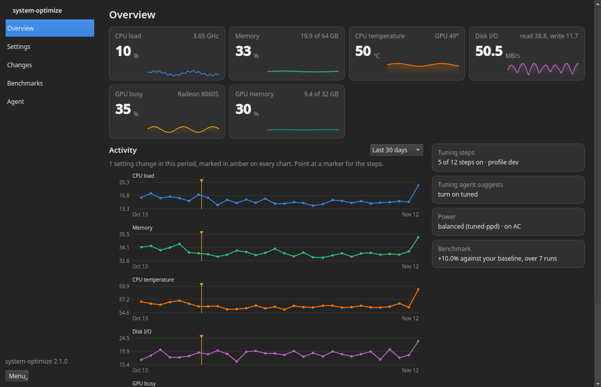
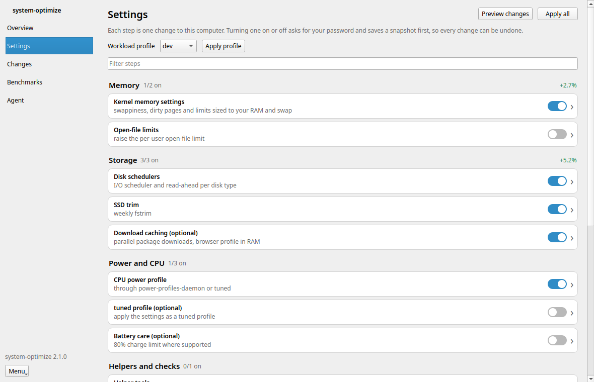
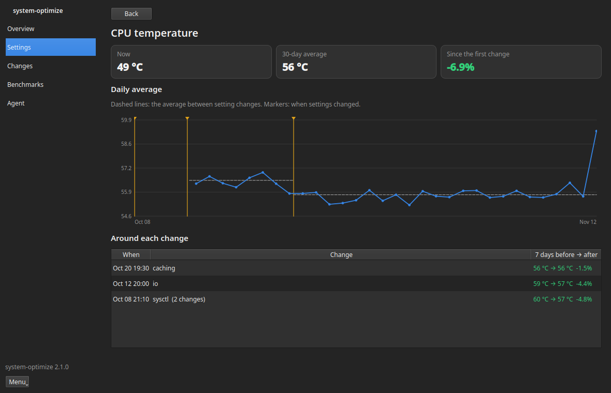

# system-optimize-tray

A tray icon and a dashboard for `system-optimize`, in two views:

- the **quick view**, from the icon: what the machine is doing right now, one
  line on the tuning steps, warnings while there are any, and the way into
  the dashboard. It changes nothing and never asks for a password.
- the **full view** (the dashboard): a normal window you can resize or
  maximize, with everything else, each thing in one place.

Every change goes through `system-optimize` itself, behind a polkit password
prompt, and can be undone.

| Overview | Settings | A resource's page |
|---|---|---|
|  |  |  |

## The quick view

    CPU 3% · 3.4 GHz · 62°C            opens the dashboard on CPU history
    Memory 32.9 of 94.0 GB (35%)       opens memory history
    Disk 1.1 MB/s                      opens disk history
    Power profile performance (tuned)
    22 of 23 steps on · profile dev    opens Settings
    ⚠ a row per warning or pressure alert, only while there are any
    Agent suggests: turn on tuned      only while one is pending
    Open dashboard
    Settings…
    Quit

It is the same on every desktop: the GNOME panel menu and the tray icon's
menu elsewhere are built from one list of rows. There are no switches in
it: they are in the dashboard's Settings.

**Quit** ends the tray app (icon, recording, window). On GNOME it closes the
dashboard, stops the monitor, and takes the indicator away for the rest of
the session: resource history and pressure alerts pause until it is back,
at your next login or as soon as you open system-optimize from the app grid.

## The full view

A sidebar with five pages; `Ctrl+1` to `Ctrl+5` switch between them.

- **Overview**: live tiles for CPU load, memory, CPU temperature and disk
  I/O (and GPU busy and GPU memory on machines with an AMD GPU), then the
  same resources as charts on one time axis (last hour, 24 hours, 7 days or
  30 days) with every setting change drawn as an amber marker through all
  of them; point at a marker for the steps that changed. Beside the charts
  in a wide window, below them in a narrow one: steps on, the power
  profile and who owns it, pressure (PSI), the hottest sensors, the
  benchmark against your baseline, and the agent's suggestion while one is
  pending. Click a tile or a chart for that resource's page.
- **Settings**: the workload profile, Apply all and Preview changes, a
  filter, and a switch per tuning step, grouped into categories (Power and
  CPU, Memory, GPU and AI, Storage, Network, Display and fonts, Boot and
  cleanup, Helpers and checks) with "n/m on" and the benchmark change
  measured after each category's changes. Click a step for its page: what
  it does and which settings it changes (from `system-optimize describe`),
  the benchmark score over time with this step's changes marked, and its
  change log. Below the steps, this app's own preferences: appearance
  (follow the desktop, light, dark), keep resource history, pressure
  notifications. After any change, an Undo button appears at the bottom of
  the window.
- **Changes**: every snapshot with what it changed and an Undo button, the
  change log across all steps with the benchmark effect, and the status
  report.
- **Benchmarks**: your first benchmark is the baseline; each later run
  shows the change. Run benchmark, the score over time with setting changes
  marked, and the runs. When system-optimize ran llama-bench, prompt and
  generation tokens/s against the first run that had them; they are kept
  out of the overall score.
- **Agent** (when the optional tuning agent is installed, below): the chat,
  the model choice, and the pending suggestion with Apply and Dismiss.

What's new (release notes in plain words, `data/whats-new.md`; they open
by themselves the first time you open the dashboard after an update), About (the open-source projects system-optimize builds on; one list,
`data/credits.json`, kept in step with `docs/tools.md` by a test) and Quit
are in the Menu button at the bottom of the sidebar.

The window follows the desktop's light or dark setting and its colours,
and uses the desktop's own font and widget style. There is one window per
user: starting it again brings the running one forward on the page asked
for.

    system-optimize-tray                    the icon and the dashboard (on GNOME, the dashboard)
    system-optimize-tray --page settings    overview | settings | changes | benchmarks | agent | about
    system-optimize-tray --resource cpu     cpu | memory | cpu_temp | disk | gpu | gpu_mem
    system-optimize-tray --autostart        only the icon (what the login autostart runs)
    system-optimize-tray --quit             quit the running one

Also watched in the background:

- **Pressure alerts**: a notification when the kernel's pressure stall
  information (`/proc/pressure`) crosses
  [psi-notify](https://github.com/cdown/psi-notify)'s thresholds (CPU 50%,
  memory 10% "some", disk I/O 15% "full", over 10 seconds). One alert per
  episode, then quiet for at least 5 minutes. If psi-notify itself is
  running, the tray leaves the notifications to it. Turn them off in
  Settings or with `PSI_ALERTS=0`.
- **Conflict warnings**: when tools that fight each other are both running,
  such as an scx (sched_ext) scheduler with ananicy-cpp. system-optimize can
  add its own (`warnings` in `--status --json`).
- **GPU memory** on AMD GPUs as VRAM (the carve-out) plus GTT (system RAM
  the GPU has mapped, which is where an APU keeps most of a local model).
  With [amdgpu_top](https://github.com/Umio-Yasuno/amdgpu_top) installed the
  numbers come from it, and the tile's tooltip names the processes using
  the most GPU memory; without it they come from amdgpu's files in `/sys`.

## GNOME, KDE and the rest

| Desktop | The icon |
|---|---|
| KDE Plasma, Xfce, LXQt, Cinnamon, MATE, Budgie | A tray icon (StatusNotifierItem). Left click opens the dashboard; its menu is the quick view. |
| GNOME 45 to 51 | GNOME has no tray. Install the **GNOME Shell extension** for a panel indicator with the readings in the top bar; its menu is the quick view. |
| GNOME with AppIndicator (Ubuntu) | Either works. When the extension is enabled the tray app steps aside so you don't get two icons (`--force` overrides). |
| Anything else | `system-optimize-tray` opens the dashboard as a window. |

The extension and the tray app read the same settings file, so the theme you
pick applies to both.

## Install

Fedora (RPM) and Debian or Ubuntu (deb) packages are built by CI from
`packaging/`:

- `system-optimize-tray`: the tray app, dashboard, root helper and polkit policy
- `gnome-shell-extension-system-optimize`: the GNOME panel menu (then
  `gnome-extensions enable system-optimize@bradvrudney.github.io` and log out and in)
- `system-optimize-agent`: the optional tuning agent

From a checkout, as yourself (system parts go through sudo):

```
tray/install.sh                      # the tray, plus the GNOME extension on GNOME
tray/install.sh --all                # tray, extension, Performance Co-Pilot and the agent
tray/install.sh --agent --model qwen3:8b --schedule "0 3 * * *"
tray/install.sh --uninstall --agent --remove-model
tray/install.sh --all --dry-run      # print the plan, change nothing
```

The parts are `--tray`, `--extension`, `--monitoring` (Performance Co-Pilot,
for long resource history) and `--agent`. Each system part is also a make
target (`sudo make -C tray install-tray`, `install-extension`, `install-agent`
and their `uninstall-*` twins). `--uninstall --monitoring` removes only the
packages the script installed.

It needs Python 3 and either PySide6 or PyQt6; `tray/install.sh` installs the
distribution's package when neither imports (`python3-pyside6` on Fedora,
`python3-pyside6.qtwidgets` on Debian and Ubuntu, `pyside6` on Arch). The
extension's menu needs only Python; the dashboard it opens needs Qt.

## How changes are made

The tray runs as you. Reading needs no privileges: the readings come from
`/proc` and `/sys`, and the steps, history and docs come from
`system-optimize --status --json`, `--history --json` and `--describe`.

Changing something runs `pkexec /usr/libexec/system-optimize/system-optimize-helper`,
which polkit lets an active local admin run after a password prompt (kept for
a few minutes, like sudo). The helper is the only part that runs as root. It:

- accepts a fixed list of actions (`apply-all`, `apply`, `enable`, `revert`,
  `undo`, `profile`, each optionally `--safe`) and step names matching
  `^[a-z][a-z0-9-]{0,31}$`, up to 32 of them;
- runs only a `system-optimize` that root owns and nobody else can write to,
  checking the file, every directory above it and its `lib/`;
- runs it with a fixed, minimal environment, never yours.

## What it needs from system-optimize

The tray reads `capabilities` from `system-optimize --status --json` and
turns off what the installed version can't do, with a tooltip saying why:

| Capability | Used for |
|---|---|
| `undo` | Undo last run |
| `enable` | turning on optional steps (`--only STEP`, which takes opt-in steps too; `--enable STEP` would run every default step as well) |
| `revert-step` | switching one step off (`--undo --only STEP`); without it, the tooltip points at Undo |
| `profile` | the profile chip and profile menu |
| `benchmark` | Run benchmark (`--benchmark-only --json`) |
| `history` | scores and change logs (`--history --json`, readable as a normal user) |
| `describe` | step pages (`--describe STEP --json`); otherwise the step's section of `--help` |
| `safe-apply` | agent proposals are applied with `--safe-apply` |

Optional fields the tray uses when they are there:

- `warnings: [{"id", "text"}]` at the top of `--status --json`: shown in the
  dashboard's warning line (the tray adds its own scx and ananicy-cpp check).
- `scores.llm_pp`, `scores.llm_tg` (tokens/s, higher is better) and
  `scores.llm_model` in each benchmark of `--history --json`: llama-bench's
  prompt processing and generation results.
- a step's `category`: new steps without one go where their name suggests
  (`gpu-memory` under GPU and AI, `scheduler` under Power and CPU, `mglru` and
  `thp` under Memory), and anything else under Other.

With system-optimize 2.0.0, which has none of the JSON output yet, the tray
still shows the live readings and the step list from `--help`, and Apply all,
Preview and Undo work; the switches show "state unknown".

## The tuning agent (optional)

The agent runs a small local model, by default **qwen3:4b** through Ollama,
once a day. It looks at system-optimize's status and benchmark history and
may suggest one change: turn a step on or off, switch profile, or undo the
last run. It can only call five tools (status, step list, history, benchmark,
propose), and a proposal must name a real step or profile. **It never applies
anything itself.** The suggestion waits in the dashboard's agent card (and
arrives as a desktop notification) until you press Apply, which goes through
the same password prompt as any other change, with `--safe-apply`.

You can also ask it questions from the dashboard or its chat page.

Before the model is asked anything, a quick **triage** looks at pressure,
readings and the journal's warnings with plain rules, and suggests a step
when a known problem (the OOM killer, I/O errors, a stalled CPU) meets a
step that is off. It runs with the daily agent run and whenever a pressure
episode begins (at most every 30 minutes): `system-optimize-agent triage` (see
[docs/triage.md](docs/triage.md), which also has the benchmark of the
optional Laya decision model).

Set it up for your user:

```
/usr/share/system-optimize-tray/install-agent.sh                   # qwen3:4b, daily
/usr/share/system-optimize-tray/install-agent.sh --model qwen3:8b --schedule "0 3 * * *"
/usr/share/system-optimize-tray/install-agent.sh --install-ollama  # installs Ollama with dnf, pacman or zypper
/usr/share/system-optimize-tray/install-agent.sh --uninstall [--remove-model]
```

**Memory:** the 4B model needs about **3 to 3.5 GB of RAM** while it runs. A
scheduled run unloads it when it finishes; a chat keeps it loaded for
`AGENT_KEEP_ALIVE` (5 minutes). The installer warns below 6 GB of RAM and 3.5
GB of free disk.

Change the model any time with `system-optimize-agent model NAME` (then
`ollama pull NAME`), or in the chat page's model picker. The schedule is a
cron expression or `@daily`, `@weekly`, `@hourly`; it becomes a systemd user
timer (`Persistent=true`, so a run missed while the laptop slept happens at
the next boot), or a crontab line where there is no systemd user session.

```
system-optimize-agent check            # is the model server up, is the model there, next run
system-optimize-agent ask "why is my disk score down?"
system-optimize-agent proposal         # what it suggested
system-optimize-agent approve          # apply it (password prompt)
system-optimize-agent schedule off
```

Settings live in `~/.config/system-optimize/agent.conf` (over
`/etc/system-optimize/agent.conf`), `KEY=value`, parsed and never sourced:

| Key | Default | |
|---|---|---|
| `AGENT_MODEL` | `qwen3:4b` | any model your server has |
| `AGENT_BACKEND` | `ollama` | or `llamacpp` (any OpenAI-compatible server) |
| `AGENT_URL` | `http://127.0.0.1:11434` | `:8080` for llamacpp |
| `AGENT_SCHEDULE` | `@daily` | cron expression, or `off` |
| `AGENT_BENCHMARK` | `1` | let a scheduled run benchmark first |
| `AGENT_NOTIFY` | `1` | desktop notification for a new suggestion |
| `AGENT_TRIAGE` | `rules` | the quick look before the model: `rules`, `laya` (optional, experimental) or `off` |
| `AGENT_TRIAGE_WAKE` | `0` | `1`: when a pressure episode leaves triage unsure, ask the model (never while memory is short) |
| `AGENT_KEEP_ALIVE` | `5m` | how long chat keeps the model loaded |

Applying suggestions without asking is deliberately not built: it would need
a polkit rule that lets the agent change the system with no password. That
is your call to make, and it is a few lines in `/etc/polkit-1/rules.d/` if
you ever want it.

## Resource history

The tray records what the tiles show (CPU load, memory, CPU temperature,
disk I/O, and GPU busy and GPU memory where there is a GPU) once a minute into `~/.local/state/system-optimize-tray/resources.db`,
as hourly and daily averages with minimum and maximum. Hourly rows are kept
for 90 days and daily rows for good, so the file stays small (about 24 rows
a day per resource). Nothing leaves the computer.

On GNOME the extension's monitor records instead (`system-optimize-tray-backend
monitor --watch --record`), since the tray app isn't running there. A
`--panel` window never records, so nothing is counted twice. Turn it off on
any resource page, or with `RECORD_HISTORY=0`.

The setting changes come from `system-optimize --history --json`; without
it the pages still show the averages, just without markers. A change's
effect compares the 7 days before it with the 7 days after; changes made in
the same run count as one. These are averages of a machine in daily use, so
a change in workload moves them as much as a setting does.

### From Performance Co-Pilot

When Performance Co-Pilot is recording this machine (`tray/install.sh
--monitoring`, or `sudo dnf install pcp-zeroconf pcp-system-tools`), the CPU,
memory and disk pages read its archives in `/var/log/pcp/pmlogger` with
`pmrep` whenever they reach back further than the tray's own recording, and
say so under the chart. The GPU and temperature pages keep using the tray's
own history. `HISTORY_SOURCE=tray` turns this off. The tray only reads the
archives; it never starts or configures PCP.

`system-optimize-tray --resource cpu|memory|cpu_temp|disk|gpu|gpu_mem` opens a resource
page directly; the GNOME menu's readouts and its Resource history submenu do
the same.

## Settings

`~/.config/system-optimize/tray.conf`, shared with the GNOME extension:

| Key | Default | |
|---|---|---|
| `THEME` | `system` | `light`, `dark` or `system` (Settings, Appearance) |
| `WINDOW` | empty | the dashboard's size when it was last closed, e.g. `1040x680,max` |
| `RECORD_HISTORY` | `1` | keep resource averages; `0` to stop |
| `HISTORY_SOURCE` | `auto` | `tray` to never read Performance Co-Pilot's archives |
| `PSI_ALERTS` | `1` | `0` turns off pressure notifications (the dashboard line stays) |

## Development

```
make -C tray test        # Python unit tests (Qt ones run offscreen, skip without Qt) and the extension's node tests
make -C tray lint
make -C tray screenshots # renders the dashboard with a fake system-optimize into tray/screenshots-out
```

The tests use a fake `system-optimize` (`tests/fixtures/fake-system-optimize`),
a fake `/proc` and `/sys`, and a fake Ollama server; nothing touches the real
system. Override the CLI with `SO_TRAY_CLI=/path/to/system-optimize`.
